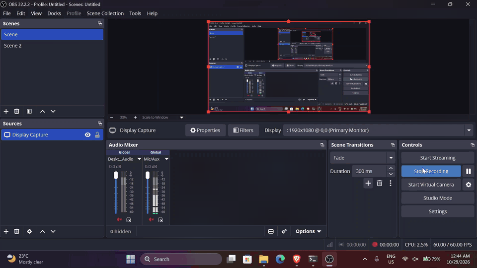

# Edge AI on the NXP i.MX 93 Ethos-U65 NPU

An int8-quantized MobileNetV2 running on the Ethos-U65 NPU of a FRDM i.MX 93, compiled with Vela, benchmarked
against the Cortex-A55 CPU, with a Python classifier that runs on either. Every number below comes from the
raw logs in `results/board/`; the tables are generated by `tools/make_results.py` into `results/results.md`.

## Demo video



The animation above (44 s, sped up 1.5x; the full-quality video is `docs/demo.mp4`) shows the local web demo
(`tools/webdemo/`): 20 photos are dropped onto the page, sent to the board over SSH, and classified live by the
Cortex-A55 CPU (2 threads, XNNPACK) and then by the Ethos-U65 NPU, with the board's SSH output on the right. In that
single run the median `invoke()` latency was 22.67 ms on the CPU and 3.58 ms on the NPU (6.3x), and the two agreed on
the top-1 label for 19 of 20 images. That is one live run for the video; the 200-run benchmark is in the table below.
Start the demo with `python3 tools/webdemo/server.py <board-ip>` and open `http://localhost:8093`.

## Board and software (`results/board_probe.txt`, `results/board/env.txt`)

- FRDM i.MX 93, NXP prebuilt Linux BSP: NXP i.MX Release Distro 6.6-scarthgap, kernel 6.6.36-lts-next, aarch64
- On-board Vela 3.12.0, `tflite_runtime` 2.16.2, Ethos-U delegate `/usr/lib/libethosu_delegate.so`, device `/dev/ethosu0`
- Laptop: Python 3.10, TensorFlow 2.15.1 (converter only, see `requirements.txt`)

## Results

Latency per inference in ms, MobileNetV2 224x224 int8, batch 1, 200 steady-state runs after 10 warm-up runs.
"Median" and "first run" come from `board/bench.py` (per-run CSVs in `results/board/`). The benchmark_model columns are
the TFLite tool's own average and first inference (it does not report a median).

| Config | Median (ms) | First run (ms) | benchmark_model avg (ms) | benchmark_model first (ms) | runs |
|---|---|---|---|---|---|
| CPU 1 thread, XNNPACK (default) | 40.59 | 46.52 | 40.66 | 46.58 | 200 |
| CPU 2 threads, XNNPACK (default) | 22.99 | 29.07 | 22.73 | 28.66 | 200 |
| CPU 1 thread, XNNPACK off | 68.21 | 74.97 | 67.59 | 74.43 | 200 |
| CPU 2 threads, XNNPACK off | 49.13 | 55.44 | 48.94 | 55.25 | 200 |
| NPU (Ethos-U65, Vela model) | 3.47 | 3.61 | 3.48 | 3.55 | 200 |

NPU speedup (ratio of medians): **6.6x** against the fastest CPU configuration measured (both A55 cores, 2 threads,
XNNPACK), and **11.7x** against a single thread with XNNPACK. Against XNNPACK-off reference kernels it is 14.1x
(2 threads) and 19.6x (1 thread).

| | Size | sha256 |
|---|---|---|
| int8 TFLite before Vela | 3,991,688 bytes | 7d2db8637b97aca727ddb80f45f60874d8cfe6753b2be5d5b09b6bdb31f6b81e |
| after Vela (NPU model) | 3,607,424 bytes | f9ba35b3a435d0e1cb14ce8d1daddc4f54294af88ee37795eb07b3188324cf50 |

**Operator placement** (`results/board/vela_summary.txt`): 96 of 96 operators on the NPU, 0 on the CPU, so there was
no operator fallback for this model. Vela's own cycle-model estimate is 4.24 ms; that is an estimate, the measured
median is 3.47 ms. Confirmed at run time: `EthosuDelegate: 1 nodes delegated out of 1 nodes` (`results/board/bm_npu.log`).

**Accuracy.** Laptop (`results/quantize_log.txt`): top-1 on 50 held-out Imagenette-val images, 1000-way argmax scored
against the mapped ImageNet class: float32 0.78, int8 0.72. On the board (`results/results.md`): int8 on the CPU 0.72,
on the NPU 0.70. CPU and NPU top-1 are identical on 49 of 50 images. The one difference (`n02979186_40.JPEG`, CPU
"cassette player" vs NPU "tape player") is a near-tie: the NPU scores both classes -41, the CPU scores -40 vs -47
(`infer_cpu.log`, `infer_npu.log`); the two int8 implementations round slightly differently. With 50 images,
read these accuracies as indicative only.

**Cortex-M33 involvement.** `/sys/class/remoteproc/remoteproc0` was `offline` before any NPU use and `running` after
the NPU runs, with `Booting fw image ethosu_firmware` in dmesg (`results/board/remoteproc_state.txt`). So on this
BSP the Ethos-U driver starts the M33 with the Ethos-U firmware the first time the NPU is used, and the NPU path depends on it.

## Method and caveats

- Latency is the `invoke()` call only (image decode and preprocessing excluded). The benchmark loop uses random int8 input
  (latency does not depend on values); `infer.py` prints per-image latency on real images.
- The first inference is reported separately from steady state on every configuration.
- The CPU baseline is the default TFLite build with XNNPACK; XNNPACK-off rows are for reference.
- Not recorded: CPU clock and governor (this BSP exposes no cpufreq sysfs), temperature, power. One board, one boot,
  one run of the suite; variation across boots was not measured.
- Cold boot (`results/cold_boot/cold_boot_npu.txt`, board freshly booted, M33 `offline`): loading the delegate
  powered up the M33 (`Booting fw image ethosu_firmware` in dmesg), and the first NPU inference then took 3.647 ms,
  the same as steady state. The M33 start-up cost therefore falls in delegate/interpreter setup; that setup time
  was not timed on the cold boot.

## Reproduce

Laptop (quantize):
```
uv venv --python 3.10 .venv && uv pip install --python .venv/bin/python -r requirements.txt
# download and extract https://s3.amazonaws.com/fast-ai-imageclas/imagenette2-320.tgz
.venv/bin/python model/quantize.py --dataset <path>/imagenette2-320
```
Bit-identical regeneration was not verified: compare the sha256 of a regenerated model with the table above before treating it as the measured one.

Board (serial console `picocom -b 115200 /dev/ttyACM1` on WSL2 after `usbipd attach`, login `root`, then SSH):
```
tools/push_to_board.sh <board-ip> <path>/imagenette2-320       # model, scripts, 50 sample images
ssh root@<board-ip> 'cd imx93 && sh run_benchmarks.sh results'  # Vela compile + every config + inference
mkdir -p results/board && ssh root@<board-ip> 'cd imx93/results && tar cf - .' | tar xf - -C results/board
.venv/bin/python tools/make_results.py                          # regenerates results/results.md
```
The exact commands of each benchmark configuration are listed in `results/board/env.txt`.
Manual classification: `python3 infer.py --device cpu|npu --model <model> --images samples [--delegate <path>]`.

Wi-Fi: the NXP driver was not loaded on this image, so I ran `modprobe moal mod_para=nxp/wifi_mod_para.conf` by hand and
gave connman the network through `/var/lib/connman/*.config`. I did not make the module load persistent or test a reboot.
No credentials are stored in this repo.

## C inference app (stretch goal)

`stretch_c_app/` is a C11 port of `infer.py` using the TFLite C API, same flags (`--device cpu|npu`, `--model`,
`--images`, `--threads`, `--delegate`, plus `--xnnpack` for the CPU path) and the same output format. The NPU path loads the
Ethos-U delegate through `TfLiteExternalDelegateCreate`. Pure logic (Pillow-compatible resize and crop, quantization,
top-k, label parsing) is separate from the TFLite glue and has host unit tests (`ctest`, 3 suites). Everything builds with
`-Wall -Wextra -Wpedantic -Wconversion -Wshadow -Wdouble-promotion -Werror`; cppcheck is clean; clang-tidy findings
are listed in NOTES.md section 8 (`results/static_analysis.txt`). The resize is checked against Pillow output by
`stretch_c_app/tests/test_imgproc.c`; on the board (`results/c_app/test_imgproc.log`) it is identical on four synthetic
images and off by at most 1 on the fifth.

Measured on the board (`results/c_app_results.md`, generated from `results/c_app/*.log`; median per-image `invoke()` over
50 images, so fewer samples than the table above):

| Config | Median (ms) | top-1 vs ground truth |
|---|---|---|
| NPU | 3.54 | 0.72 |
| CPU 1 thread, XNNPACK | 40.37 | 0.72 |
| CPU 2 threads, XNNPACK | 22.77 | 0.72 |
| CPU 1 thread, no XNNPACK | 67.91 | 0.72 |
| CPU 2 threads, no XNNPACK | 49.10 | 0.72 |

- The C CPU path does not use XNNPACK by default: `results/c_app/c_cpu_1t.err` is empty, while the `--xnnpack` runs
  log `Created TensorFlow Lite XNNPACK delegate for CPU.` (`c_cpu_1t_xnnpack.err`). The flag adds the delegate
  explicitly. Compare the NPU against the XNNPACK rows.
- The C and Python apps are **not** bit-identical: top-1 matches on 48 of 50 images on the NPU and 47 of 50 on the CPU
  with XNNPACK. The C app decodes JPEGs with stb_image and the Python app with Pillow (libjpeg), and the two decoders
  produce slightly different pixels. That is the likely cause but I did not isolate it. One of the differing images
  (`n02102040_5802.JPEG`) changes class entirely (skunk vs Tibetan mastiff), so the models are sensitive on it. I checked
  with Pillow that it, `n03425413_13821.JPEG` and `n02979186_40.JPEG` are ordinary baseline RGB JPEGs (no CMYK or
  progressive encoding), which rules out those two color-handling causes only.
- Build and run on the board (it has gcc and cmake): `tools/fetch_c_deps.py` downloads the TF 2.16.2 C headers and
  stb_image.h (pinned, hash-checked; the board has no headers), then `sh stretch_c_app/run_c_app.sh results_c` builds,
  runs the unit tests and every configuration. The exact commands are in `results/c_app/env.txt`.

## A55 to M33 RPMsg ping-pong (stretch goal)

`board/rpmsg_pingpong.sh` swaps the firmware on the Cortex-M33 (`remoteproc0`) from `ethosu_firmware` to NXP's prebuilt
`imx93-11x11-evk_m33_TCM_rpmsg_lite_pingpong_rtos_linux_remote.elf` (shipped in the BSP's `/lib/firmware`), loads the Linux
`imx_rpmsg_pingpong` module, lets the demo run, then restores the Ethos-U firmware. Result (`results/rpmsg/`):

- dmesg shows the M33 booting the demo firmware, the channel `rpmsg-openamp-demo-channel` appearing, and Linux receiving
  51 messages, the odd numbers 1 to 101 in order, followed by the demo's own "goodbye!".
- After the script, `remoteproc0` was back on `ethosu_firmware`, `running` (`results/rpmsg/summary.txt`), and the script's
  `infer.py --device npu` run completed with exit code 0 at about 3.6 ms per image (`results/rpmsg/npu_after_restore.log`).

What this does and does not show: the A55 and M33 can exchange RPMsg messages on this FRDM board. The M33 code is **NXP's
prebuilt demo, not code I wrote**, and it was built for the 11x11 EVK, not the FRDM. It worked, presumably because RPMsg
uses only SoC-level resources (messaging unit and shared memory), but I did not check that explanation, and I did not look at
the M33 console output. The M33 can run only one firmware at a time, so this demo and the NPU cannot be used simultaneously.

## Roadmap

Not done yet: power measurement (no USB power meter available), custom Yocto image and the later items.

## License

MIT, see `LICENSE`. Copyright (c) 2026 Anurag Kumar (anuragak021).

Third-party material is not part of this repository and keeps its own license: the TensorFlow Lite C API headers and
`stb_image.h` are downloaded by `tools/fetch_c_deps.py`, and the NXP BSP software on the board (Vela, the Ethos-U
delegate and firmware, the prebuilt M33 demo firmware) belongs to NXP and Arm under their own terms.
